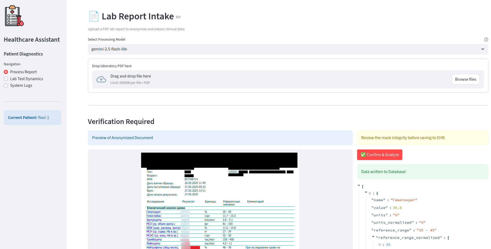
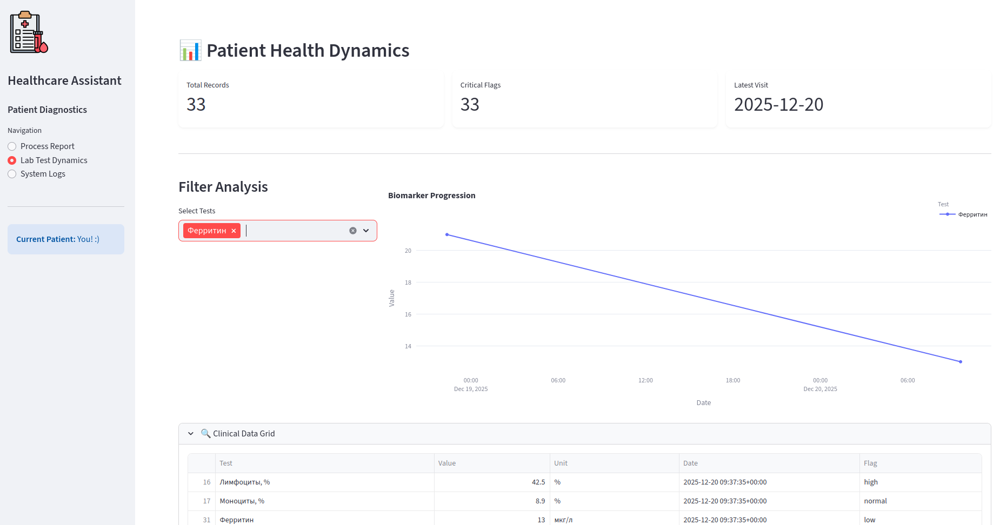

# Healthcare Assistant

Healthcare Assistant turns personal laboratory PDFs into structured results you can
review and track over time. It is a Streamlit application under active development,
currently focused on laboratory reports and a single patient profile.

The app helps redact personal information locally, asks you to review the document,
then uses LlamaParse and Gemini to extract results. PostgreSQL stores the reports
and observations. The current extraction default is **prompt v4** with
`gemini-3.1-flash-lite`.

## Get started

Use Docker and the VS Code Dev Containers extension for the supported development
setup. Create a root `.env` using `.env.example`, configure the API credentials and
database settings, and select **Dev Containers: Reopen in Container**. Follow the
[application guide](docs/application_guide.md) for the exact setup and prerequisites.

From the container terminal:

```sh
poetry run streamlit run src/app.py --server.address=0.0.0.0 --server.port=8501
```

Open the forwarded port **8501** in your browser. Existing installations should
check the [v4 upgrade instructions](docs/v4_application_update.md#upgrading-an-existing-database)
before starting the updated app.

## Use the app

1. Open **Process Report**, upload a laboratory PDF, and click **Start Anonymization**.
2. Inspect the redacted PDF carefully. Choose **Reject / Delete** if it is unsuitable,
   or **Confirm & Analyze** to send it for parsing and extraction.
3. Review the structured results and any extraction warnings.
4. Open **Lab Test Dynamics** to browse the results table, filter by date and test,
   and view numeric trends.

❗ **Review before confirming:** redaction can miss personal information. LlamaParse
receives the reviewed PDF and Gemini receives the parsed text. This is an
experimental personal-data tool, not a validated clinical decision system.

The table includes numeric, qualitative, and measured-range results. Charts show
only exact numeric measurements with known dates; limits and text stay in the table.
Different units use separate series. An unknown flag does not mean a normal result.





Screenshots illustrate the workflow and may predate the latest interface changes.

## Documentation

| Guide | What it covers |
| --- | --- |
| [Application guide](docs/application_guide.md) | Setup, daily use, configuration, and troubleshooting |
| [Project overview](docs/project_overview.md) | Architecture, components, data flow, and limitations |
| [v4 application update](docs/v4_application_update.md) | Storage/display changes, database migration, recovery scripts, and verification |
| [Prompt evaluation](docs/prompt_evaluation.md) | v3/v4 contract, recorded results, and fresh-run tooling |
| [Small-model training experiment](docs/llm_training_experiment.md) | Motivation, proposed dataset strategy, baselines, training, and evaluation |
